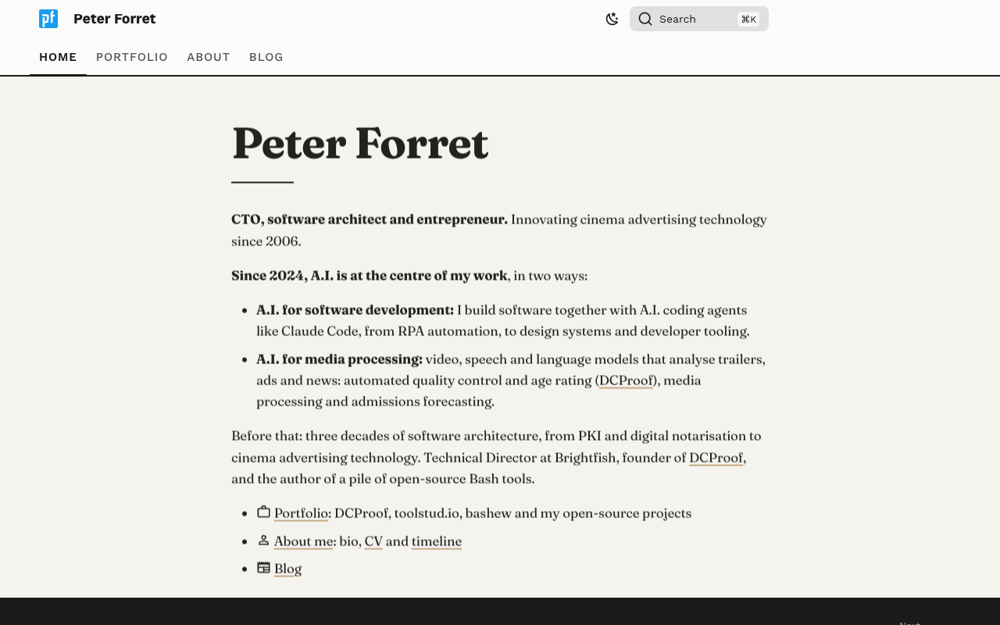

# www.forret.com

Personal website of **Peter Forret**, tech consultant and entrepreneur: portfolio, CV, career
timeline and blog.

**Live site:** <https://www.forret.com/>



## Contents

- **Portfolio**: DCProof, toolstud.io, bashew and the open-source projects on GitHub
- **About**: bio, CV and career timeline
- **Blog**: posts, with an RSS feed

## Stack

- [Zensical](https://zensical.org/) (the successor of Material for MkDocs), run in Docker through
  the `mkdox2` wrapper (image `pforret/mkdox-zensical`)
- Markdown content in `docs/`, all configuration in `zensical.toml`
- A custom "vintage editorial" theme in `docs/stylesheets/extra.css` (Fraunces, Work Sans,
  JetBrains Mono, light and dark mode)
- Cookieless analytics by Simple Analytics

## Usage

```bash
mkdox2 serve        # local preview with live reload
mkdox2 build        # build into site/, then git add + commit + push (= publish)
mkdox2 post         # scaffold a new blog post
```

Test build without committing:

```bash
docker run --platform linux/amd64 --rm -v "$PWD":/docs pforret/mkdox-zensical build
```

## Publishing

The site is built locally and the generated `site/` folder is committed. On every push to `main`
that changes `site/**`, the GitHub Actions workflow `.github/workflows/pages.yml` uploads `site/`
unchanged to GitHub Pages. There is no build step in CI.

## Layout

| Path | Contents |
|------|----------|
| `docs/` | Markdown content, theme overrides, stylesheets, icons |
| `docs/todo/` | internal todo tracking (excluded from the build) |
| `scripts/` | helper scripts, e.g. `portfolio_repos.sh` to regenerate the open-source list |
| `site/` | build output, committed and served by GitHub Pages |
| `zensical.toml` | site configuration |

© 2004–2026 Peter Forret
