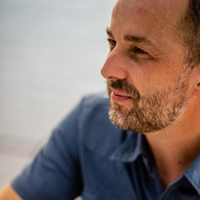

# About

{ align=right width=180 }

**Innovating cinema advertising technology since 2006.**

I'm Peter Forret: CTO, software architect and entrepreneur.
I take products from product management and software architecture all the way to implementation.
Today I'm Technical Director at Brightfish, and in 2026 I started building [DCProof](../portfolio/dcproof.md).

## A.I. first, since 2024

For the last two years, A.I. has been at the heart of almost everything I build:

- **A.I. for software development:** I work with A.I. coding agents (Claude Code) every day: they write, run and fix code
  with me. One example: record a browser task once, and Claude Code turns it into a tested Playwright script exposed as an API.
- **A.I. for media processing:** at Brightfish I build A.I.-assisted applications for news analysis, media processing
  and admissions forecasting. With DCProof, video, speech and language models rate a trailer or ad for
  Kijkwijzer, FSK, BBFC and MPAA in one pass, and explain every rating.

## What I work on

- **A.I.:** A.I.-assisted software development, audio/video quality control, forecasting, MCP services
- **(Web) application architecture:** product requirements and technical writing
- **Microservices, DevOps and automation:** PKI and security
- **Audio, video and image processing**

## Where to find me

- :material-map-marker: Based in Grimbergen, Belgium. Available for remote work or work within Belgium.
- :material-email: [peter@forret.com](mailto:peter@forret.com)
- :fontawesome-brands-linkedin: [LinkedIn](https://www.linkedin.com/in/peterforret/) · :fontawesome-brands-github: [GitHub](https://github.com/pforret) · :material-newspaper: [blog.forret.com](https://blog.forret.com/) · :material-file-account: [cv.forret.com](https://cv.forret.com/)

-   :material-file-document-outline:{ .lg .middle } **CV**

    ---

    Experience, side projects and education, from Sopres (1993) to DCProof (2026).

    [:octicons-arrow-right-24: Read the CV](cv.md)

-   :material-timeline-clock-outline:{ .lg .middle } **Timeline**

    ---

    Three decades of PKI, cinema advertising tech and A.I. on one page.

    [:octicons-arrow-right-24: See the timeline](timeline.md)

-   :material-briefcase-outline:{ .lg .middle } **Portfolio**

    ---

    DCProof, toolstud.io, bashew and my open-source projects.

    [:octicons-arrow-right-24: View the portfolio](../portfolio/index.md)

