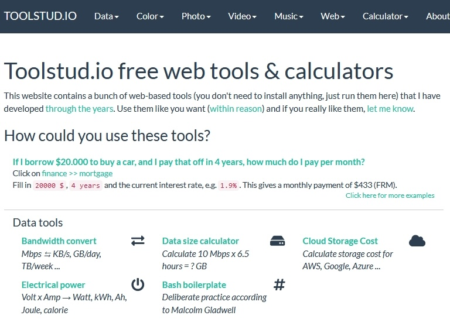

# toolstud.io

**Role:** Founder · **Website:** [toolstud.io](https://toolstud.io)

toolstud.io is a collection of free web-based calculators, converters and other tools,
and one of my oldest projects.

## Tools by audience

=== "Webmasters & sysadmins"

    - [Bandwidth converter](https://toolstud.io/data/bandwidth.php): GB/month, Mbps, MB/hour
    - [Megapixel calculator](https://toolstud.io/photo/megapixel.php): image size for TIF, BMP, JPG and PNG, plus aspect ratio
    - [HTTPS config check](https://toolstud.io/network/https.php)
    - [HTTP redirection check](https://toolstud.io/network/redirect.php)

=== "Musicians"

    - [BPM calculator](https://toolstud.io/music/bpm.php): BPM to milliseconds
    - [Audio delay calculator](https://toolstud.io/music/delay.php)
    - [Musical frequency calculator](https://toolstud.io/music/hertz.php): notes and Hz

=== "Photo & video"

    - [Aspect ratio calculator](https://toolstud.io/photo/aspect.php)
    - [Video file-size calculator](https://toolstud.io/video/filesize.php)
    - [Video frame-rate conversion](https://toolstud.io/video/framerate.php)
    - [Depth-of-field calculator](https://toolstud.io/photo/dof.php)
